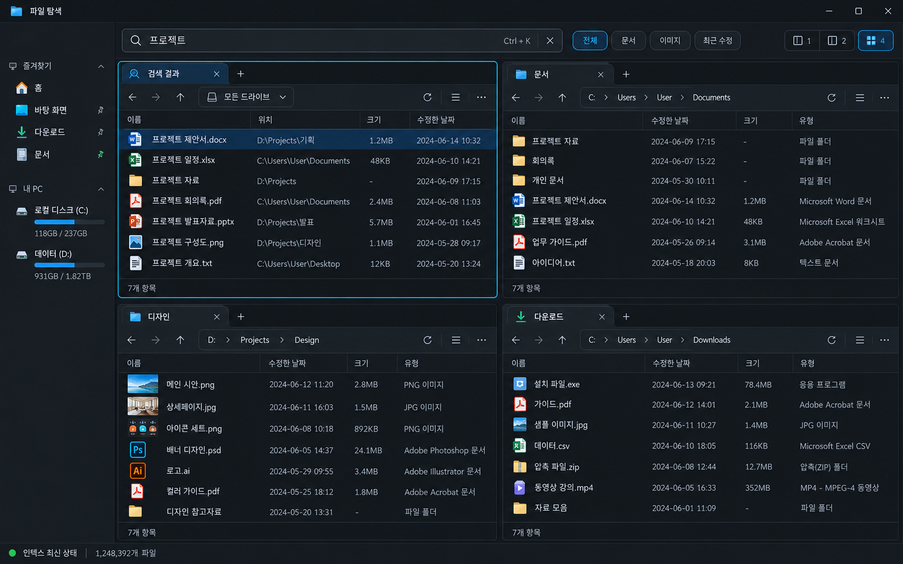

# QuadFinder

Everything의 빠른 파일명 검색과 Q-Dir의 다중 패널 탐색 경험을 결합하는 Windows 파일 관리자입니다.



## 현재 구현 — v0.1.2

시안의 한 줄 검색 도구 모음, 컬러 파일 아이콘, 폴더 경로 표시, 패널 비율과 글자 크기를 반영했습니다. 드라이브 사용량은 실제 로컬 볼륨에서 읽고, 이미지 파일은 Windows에서 제공하는 썸네일을 표시합니다.

버튼·탭·상태 표시줄은 그라데이션과 그림자 없이 단색으로 표시합니다. 왼쪽 탐색 영역은 12px 글자와 18px 아이콘으로 구성하며, 오른쪽 경계를 드래그해서 너비를 조절할 수 있습니다. 조절한 너비는 자동 저장됩니다. 경계를 더블클릭하면 기본 너비로 돌아오며, 경계에 포커스한 상태에서 방향키·Home·End로도 조절할 수 있습니다.

아래는 현재 UI를 예시 데이터로 실행한 화면입니다. 일반 앱 실행은 실제 로컬 파일을 사용합니다.


- 실제 로컬 폴더 탐색, 경로 직접 입력, 뒤로/앞으로/상위 폴더 이동
- 1·2·4분할 화면, 패널별 독립 탭, 이름·날짜·크기 정렬
- 바탕 화면·문서·다운로드·사진 및 직접 추가한 폴더의 백그라운드 파일명 인덱스
- 검색어 단어 조합, 문서/이미지/최근 7일 필터, 검색 결과에서 폴더 위치 열기
- 새 폴더 생성, 기본 앱에서 파일 열기, 우클릭으로 Windows 탐색기에 위치 표시
- 패널 배치와 탭 경로의 로컬 저장, 한국어 다크 테마, 키보드 단축키

현재는 초기 개발 버전입니다. 자체 파일 순회 인덱스로 동작하며 Everything의 NTFS/MFT 수준 검색 속도를 구현한 상태는 아닙니다. 파일 복사·이동·삭제는 아직 제공하지 않습니다.

## 개발 실행

Node.js 22 이상과 pnpm 11이 필요합니다.

```powershell
pnpm install --frozen-lockfile
pnpm start
```

Electron 설치 시 바이너리가 설치되지 않았다면 `node node_modules/electron/install.js`를 실행합니다. pnpm의 빌드 정책은 `pnpm-workspace.yaml`에 Electron 설치 스크립트만 허용합니다.

```powershell
pnpm test       # 실제 파일 시스템 및 검색 워커 테스트
pnpm smoke      # Electron 시작·실제 파일 목록·스크린샷 검증
pnpm preview    # http://127.0.0.1:4173 디자인 확인용, 예시 데이터
pnpm design:check # 시안 크기와 작은 창의 실제 Electron 화면 캡처, 예시 데이터
pnpm package    # release/0.1.2/QuadFinder-win32-x64/QuadFinder.exe
```

## 검색 범위와 제한

첫 실행에 알려진 사용자 폴더만 수집하며, `폴더 추가`로 범위를 확장합니다. 심볼릭 링크와 node_modules, .git, 시스템 휴지통은 제외합니다. 현재 인덱스는 메모리에서 최대 25만 항목까지 수집하고, 검색 결과는 최대 1,000개, 폴더 목록은 최대 2,000개를 표시합니다. 상한을 넘으면 UI에 표시합니다. 검색 대상 파일의 본문은 읽지 않습니다. 새 파일을 반영하려면 검색 필터 오른쪽의 새로고침을 누릅니다. 실행을 종료하면 인덱스는 사라집니다. 추가 검색 폴더는 다음 실행에 다시 추가해야 합니다.

탭 경로는 앱 데이터 폴더에 저장되며 Git에 포함되지 않습니다. 앱은 사용자 파일 목록을 서버로 전송하지 않습니다. Electron 렌더러의 Node 접근을 차단하고, 제한된 preload API로 파일 작업을 수행합니다.

## 단축키

| 단축키 | 동작 |
|---|---|
| Ctrl K | 검색창 포커스 |
| Ctrl T | 활성 패널 새 탭 |
| Ctrl L | 활성 패널 경로 입력 (또는 경로 더블클릭) |
| Alt ↑ | 상위 폴더 |
| F5 | 활성 패널 새로고침 |
| Enter | 선택한 파일 열기 / 폴더 이동 |

## 구조

`src/main.cjs`는 앱 창·IPC·로컬 설정을, `src/files.cjs`는 경로 검증과 파일 시스템을, `src/index-worker.cjs`는 별도 스레드의 검색 인덱스를 담당합니다. `src/renderer`에는 UI가 있습니다. 브라우저 미리보기의 예시 데이터는 실제 데스크톱 파일 API와 분리되어 있습니다.

## 다음 개발 단계

1. 안전한 복사·이동 작업 큐, 충돌 처리, 진행 표시, 휴지통
2. Everything IPC 연동 또는 NTFS USN/MFT 인덱싱, 영속 인덱스 및 실시간 갱신
3. 멀티 선택, 끌어 놓기, 크기 조절 가능한 패널, 썸네일·미리보기
4. 밝은 테마, 설치 프로그램, 서명 및 배포

공개 저장소이며 배포 라이선스는 아직 지정하지 않았습니다.
