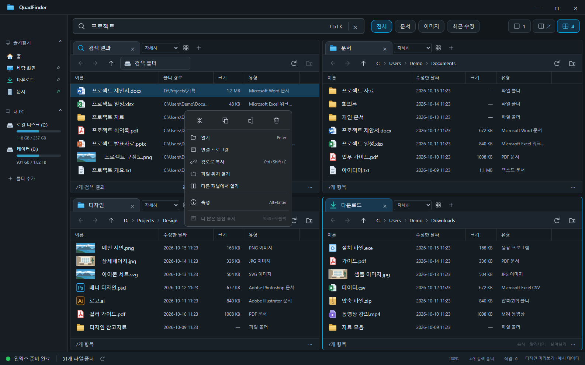

# QuadFinder

Everything의 빠른 파일명 검색과 Q-Dir의 다중 패널 탐색 경험을 결합하는 Windows 파일 관리자입니다.


## 현재 구현 — v0.5.0

폴더·문서·돋보기 모양의 대표 아이콘을 창·작업 표시줄·실행 파일에 적용했습니다. 원본은 `assets/app-icon.svg`이며 `pnpm icon:build`로 PNG와 Windows ICO(16~256px)를 다시 생성할 수 있습니다.

시안의 한 줄 검색 도구 모음, 컬러 파일 아이콘, 폴더 경로 표시, 패널 비율과 글자 크기를 반영했습니다. 드라이브 사용량은 실제 로컬 볼륨에서 읽고, 이미지 파일은 Windows에서 제공하는 썸네일을 표시합니다.

버튼·탭·상태 표시줄은 그라데이션과 그림자 없이 단색으로 표시합니다. 왼쪽 탐색 영역은 12px 글자와 18px 아이콘으로 구성하며, 오른쪽 경계를 드래그해서 너비를 조절할 수 있습니다. 조절한 너비는 자동 저장됩니다. 경계를 더블클릭하면 기본 너비로 돌아오며, 경계에 포커스한 상태에서 방향키·Home·End로도 조절할 수 있습니다.

Ctrl+마우스 휠로 글자·아이콘·버튼·패널·상태 표시줄을 함께 확대·축소합니다. 배율은 70~150%에서 10%씩 바뀌고 자동 저장됩니다. 일반 휠은 기존처럼 스크롤하며, Ctrl+0 또는 상태 표시줄의 배율 버튼으로 100%로 돌아갑니다. Ctrl++/Ctrl+-도 사용할 수 있습니다.

아래는 현재 UI를 예시 데이터로 실행한 화면입니다. 일반 앱 실행은 실제 파일과 연결된 공유 폴더를 사용합니다.


- 로컬·UNC 네트워크 공유 폴더 탐색, 경로 직접 입력, 뒤로/앞으로/상위 폴더 이동
- 1·2·4분할 화면, 패널별 독립 탭, 이름·날짜·크기 정렬
- 바탕 화면·문서·다운로드·사진 및 직접 추가한 폴더의 백그라운드 파일명 인덱스
- 검색어 단어 조합, 문서/이미지/최근 7일 필터, 검색 결과에서 폴더 위치 열기
- 새 폴더 생성, 기본 앱에서 파일 열기, 우클릭으로 Windows 탐색기에 위치 표시
- 패널 배치와 탭 경로의 로컬 저장, 한국어 다크 테마, 키보드 단축키
- Ctrl·Shift·Ctrl+A 다중 선택, 복사·잘라내기·붙여넣기, 폴더 재귀 복사, 이름 변경
- 패널 간 드래그 복사, Shift+드래그 이동, 외부 파일 드래그 가져오기
- Windows 휴지통 삭제, 순차 작업 큐, 바이트 진행 표시, 취소, 항목별 오류 표시
- 이름 충돌 시 둘 다 유지·건너뛰기·취소 및 작업 전체에 같은 선택 적용
- 우클릭 작업 메뉴, 파일 정보, 다른 패널에서 위치 열기, Ctrl+W 탭 닫기
- 검색 폴더 추가·제외·재실행 후 복원, 사용자 폴더 외 추가한 폴더의 사이드바 바로가기
- 영속 인덱스 캐시 및 변경 경로만 갱신하는 증분 인덱싱
- 8가지 보기: 아주 큰·큰·보통·작은 아이콘, 목록, 자세히, 타일, 콘텐츠
- Windows 숨김 속성 기반 표시, 확장명·확인란 표시, 정렬·그룹 접기/펼치기
- 자세히 보기 열 선택·순서 변경·드래그 너비 조절·자동 맞춤 및 폴더별 저장
- 텍스트·이미지·PDF 미리보기와 세부 정보 창, Alt+P로 미리보기 전환
- Windows 11 형태의 우클릭 메뉴와 실제 Windows 셸 확장 메뉴, 시스템 속성·연결 프로그램
- Windows 탐색기와 파일 복사·잘라내기 클립보드 공유, 경로 복사

기본 파일 관리 기능을 갖춘 개발 버전입니다. 자체 파일 순회 인덱스로 동작하며 Everything의 NTFS/MFT 수준 검색 속도를 구현한 상태는 아닙니다.

## 보기 옵션과 우클릭

패널 탭 옆의 보기 옵션 버튼에서 숨긴 항목·확장명·확인란, 정렬·그룹화, 미리보기·세부 정보 창을 설정합니다. 자세히 보기에서는 열 경계를 드래그하거나 더블클릭해서 너비를 맞추고, 열 제목을 드래그하여 순서를 바꿉니다. 열 제목 우클릭으로 열을 추가·제거할 수도 있습니다. 설정은 폴더별로 저장하며 보기 옵션에서 초기화할 수 있습니다.




기본 우클릭 메뉴는 Windows 11의 아이콘 명령 모음과 구분선·배치를 앱의 평면 다크 UI에 맞춰 구현했습니다. **더 많은 옵션 표시** 또는 **Shift+우클릭**은 Windows IContextMenu가 제공하는 실제 확장 메뉴를 엽니다. 이는 Windows 11의 새 메뉴 자체가 아니라 탐색기의 확장 메뉴에 해당하며, 시스템 테마와 설치된 셸 확장에 따라 모양과 항목이 달라집니다. 검색 결과에서 서로 다른 폴더의 파일을 함께 선택한 경우 시스템 확장 메뉴는 같은 폴더별로 사용해야 합니다. 셸 확장 명령의 진행·확인 창은 해당 프로그램이 제공하며 앱의 작업 큐와 별도로 동작합니다.

미리보기는 로컬 텍스트(앞부분 128 KB), PNG/JPEG/WebP/BMP/GIF/AVIF 이미지와 PDF를 지원합니다. 40 MB를 초과하는 파일은 내용 미리보기를 생략합니다. 텍스트와 HTML은 실행하지 않고 글자로 표시하며 PDF는 Chromium의 PDF 뷰어를 사용합니다. Word·Excel 본문 미리보기는 아직 지원하지 않습니다.

## 네비게이션

- 즐겨찾기·내 PC 제목을 클릭하거나 Enter/Space로 접기·펼치기. 접힘 상태는 저장됩니다.
- 각 항목 왼쪽 화살표로 하위 폴더를 펼칩니다. 실제로 펼친 폴더만 읽고, 접힌 섹션의 하위 폴더는 펼칠 때 불러옵니다. 오류 시 다시 시도할 수 있습니다.
- 현재 폴더 고정 버튼, 폴더 경로 입력 또는 선택으로 로컬·UNC 폴더를 추가합니다. `검색 대상에도 포함`을 끄면 바로가기만 추가합니다.
- 추가한 바로가기의 드래그 순서 변경, 우클릭으로 표시 이름 변경·위아래 이동·제거. 표시 이름과 순서를 저장하며 실제 폴더는 변경하지 않습니다.
- Ctrl+클릭·휠클릭 또는 우클릭 메뉴로 새 탭에서 열기, 다른 패널에서 열기, Windows 탐색기 열기, 경로 복사·속성을 제공합니다.
- 즐겨찾기 제목이나 고정 영역에 폴더를 놓으면 바로가기로 고정합니다. 폴더 항목에 파일을 놓으면 해당 폴더로 복사하고 Shift를 누르면 이동합니다.
- 바로가기 제거와 검색 대상 제외는 별도 명령입니다. 네비바에서 Delete는 추가한 바로가기만 제거하며 실제 폴더를 삭제하지 않습니다.
- 네비바 새로고침 버튼·F5로 폴더 트리와 드라이브 용량을 다시 확인합니다. 방향키로 항목 이동·펼치기·접기를 지원하며 목록이 길면 네비바 안에서 스크롤합니다.

## 자동 갱신과 네트워크 폴더

파일 변경 알림은 해당 폴더를 표시하는 패널에만 반영합니다. 앱이 포커스를 잃으면 화면 갱신을 보류하고, 포커스가 돌아오면 한 번에 갱신합니다. 목록이 같으면 다시 그리지 않고, 실제 변경이 있더라도 탭·주소 표시줄·스크롤·선택 상태를 유지합니다. 검색 인덱스의 진행 알림마다 검색 화면을 비우던 동작도 제거했습니다.

사이드바는 현재 활성 패널의 경로에 맞춰 가장 가까운 즐겨찾기·추가 폴더를 강조합니다. 패널·탭 전환과 뒤로가기 후에도 선택 표시를 동기화합니다.

`폴더 추가`의 폴더 선택 창 또는 검색 폴더 관리의 경로 입력에서 `\\NAS\공유폴더`를 추가할 수 있습니다. Windows에 연결된 공유 계정을 사용하며 경로·추가 폴더·보기 설정을 저장하고 복원합니다. UNC 주소 표시줄은 서버와 공유 이름을 하나의 루트로 취급합니다. 네트워크 파일 변경 감지는 서버에 따라 지원 범위가 달라 포커스 복귀 시 보이는 폴더를 다시 확인하며, F5로도 갱신할 수 있습니다. 전체 인덱스는 상태 표시줄의 수동 갱신으로 다시 수집할 수 있습니다.

## 파일 작업

파일을 Ctrl/Shift로 여러 개 선택한 뒤 Ctrl+C 또는 Ctrl+X, 대상 패널에서 Ctrl+V를 사용합니다. 드래그는 기본 복사이고 Shift를 누르면 이동합니다. F6으로 대상 폴더를 직접 골라 이동할 수도 있습니다. Delete는 확인 후 Windows 휴지통으로 보냅니다. 앱 자체 삭제는 휴지통 이동이며, 시스템 확장 메뉴에서 실행하는 명령은 Windows와 설치된 셸 확장 프로그램이 처리합니다.

앱 작업 큐의 이동은 복사를 완료하고 원본이 바뀌지 않았는지 확인한 뒤 원본을 휴지통으로 보냅니다. 따라서 원본은 Windows 휴지통에서 복원할 수 있고, 복사 중에는 추가 여유 공간이 필요합니다. 원본 변경 또는 휴지통 오류가 나면 원본을 유지하고 작업 창에 오류를 표시합니다. 완료된 항목은 작업 취소 시 되돌리지 않습니다. 실행 중인 작업이 있으면 창을 닫기 전에 완료하거나 취소해야 합니다.

앱 작업 큐는 기존 파일을 덮어쓰지 않습니다. 충돌 시 새 이름으로 둘 다 유지하거나 건너뛸 수 있습니다. 연결·정션이 포함된 폴더 복사/이동은 지원하지 않습니다. 네트워크 공유의 휴지통 이동 가능 여부는 Windows와 공유 서버의 지원에 따르며, 실패하면 오류를 표시하고 영구 삭제로 대신하지 않습니다. Windows 파일 클립보드를 공유하므로 탐색기와 Ctrl+C/X/V로 파일을 주고받을 수 있습니다. 외부 파일은 드래그해서 가져올 수 있습니다.

## 개발 실행

Windows x64, Node.js 22 이상과 pnpm 11이 필요합니다. 셸 브리지는 Windows의 .NET Framework 4.x C# 컴파일러로 개발 실행 시 자동 빌드합니다. 패키지에는 컴파일된 브리지가 포함됩니다.

```powershell
pnpm install --frozen-lockfile
pnpm start
```

Electron 설치 시 바이너리가 설치되지 않았다면 `node node_modules/electron/install.js`를 실행합니다. pnpm의 빌드 정책은 `pnpm-workspace.yaml`에 Electron 설치 스크립트만 허용합니다.

```powershell
pnpm test       # 실제 파일 시스템 및 검색 워커 테스트
pnpm smoke      # 실제 UI 선택→복사→충돌→이름 변경→드래그 이동→Windows 휴지통 검증
pnpm preview    # http://127.0.0.1:4173 디자인 확인용, 예시 데이터
pnpm design:check # 시안 크기와 작은 창의 실제 Electron 화면 캡처, 예시 데이터
pnpm package    # release/0.5.0/QuadFinder-win32-x64/QuadFinder.exe
```

## 검색 범위와 제한

첫 실행에 알려진 사용자 폴더만 수집하며, `폴더 추가` 또는 상태 표시줄의 검색 폴더 관리로 범위를 바꿉니다. 설정과 인덱스 캐시는 로컬 앱 데이터 폴더에 저장합니다. 심볼릭 링크와 node_modules, .git, 앱 자체 설정 폴더, 시스템 휴지통은 제외합니다. 최대 25만 항목을 수집하고 검색 결과는 상위 1,000개를 표시합니다. 일반 폴더 목록은 2,000개씩 추가 표시할 수 있습니다. 상한을 넘으면 UI에 표시합니다. 파일 본문은 검색하지 않습니다.

폴더 변경을 감지해 해당 파일 또는 하위 폴더만 갱신합니다. 주기적인 전체 재수집은 하지 않으며, 변경 감지가 지원되지 않는 볼륨에서는 수동 갱신이 필요합니다. 수동 갱신은 상태 표시줄의 새로고침으로 가능합니다. 첫 수집에는 파일 수와 디스크 속도에 따라 시간이 필요하고, 캐시를 읽은 뒤에는 이전 결과로 검색하면서 갱신합니다.

| 검색어 예시 | 동작 |
|---|---|
| `프로젝트 보고서` | 두 단어를 모두 포함 |
| `"최종 보고서"` | 연속된 구문 포함 |
| `*.pdf` | 파일명 와일드카드 (`*`, `?`) |
| `ext:pdf;docx` | 확장자 조건 |
| `path:Projects` | 경로 조건 |
| `size:>10mb` | 파일 크기 조건 (`b`, `kb`, `mb`, `gb`, `tb`) |

탭 경로는 앱 데이터 폴더에 저장되며 Git에 포함되지 않습니다. 앱은 사용자 파일 목록을 서버로 전송하지 않습니다. Electron 렌더러의 Node 접근을 차단하고, 제한된 preload API로 파일 작업을 수행합니다.

## 단축키

| 단축키 | 동작 |
|---|---|
| Ctrl K | 검색창 포커스 |
| Ctrl + 마우스 휠 / Ctrl + +·- | 전체 화면 크기 조절 |
| Ctrl 0 | 배율 100%로 초기화 |
| Ctrl T | 활성 패널 새 탭 |
| Alt P | 미리보기 창 켜기·끄기 |
| Shift+우클릭 | Windows 시스템 확장 메뉴 |
| Ctrl Shift C | 선택한 파일의 경로 복사 |
| Ctrl W | 활성 패널 현재 탭 닫기 |
| Ctrl L | 활성 패널 경로 입력 (또는 경로 더블클릭) |
| Ctrl A / Ctrl·Shift+클릭 | 현재 표시한 파일 전체 / 복수·범위 선택 |
| Ctrl C / Ctrl X / Ctrl V | 복사 / 잘라내기 / 붙여넣기 |
| Ctrl Shift N | 새 폴더 |
| F2 | 이름 변경 |
| F6 | 대상 폴더를 선택하여 이동 |
| Delete | 휴지통 이동 |
| Alt Enter | 파일 정보 |
| 마우스 뒤로/앞으로 버튼 · Alt ←/→ | 활성 패널의 현재 탭에서 이전/다음 폴더 |
| Alt ↑ | 상위 폴더 |
| F5 | 활성 패널 새로고침 |
| Enter | 선택한 파일 열기 / 폴더 이동 |

## 구조

`src/main.cjs`는 앱 창·IPC·로컬 설정·폴더 감시를, `src/files.cjs`는 경로 검증과 검색 조건을, `src/operations.cjs`는 파일 작업 큐·검증·취소를, `src/index-worker.cjs`는 별도 스레드의 검색 인덱스와 캐시를 담당합니다. `src/renderer/features.js`에는 파일 선택과 메뉴·작업 UI가 있습니다. 브라우저 미리보기의 예시 데이터는 실제 데스크톱 파일 API와 분리되어 있습니다.

## 다음 개발 단계

1. Everything IPC 연동 또는 NTFS USN/MFT 인덱싱과 대용량 검색
2. 파일 작업 실행 취소, 네트워크 서버 탐색·계정 관리
3. 크기 조절 가능한 파일 패널, Office 본문 미리보기, 밝은 테마
4. 설치 프로그램, 코드 서명 및 배포

공개 저장소이며 배포 라이선스는 아직 지정하지 않았습니다.
