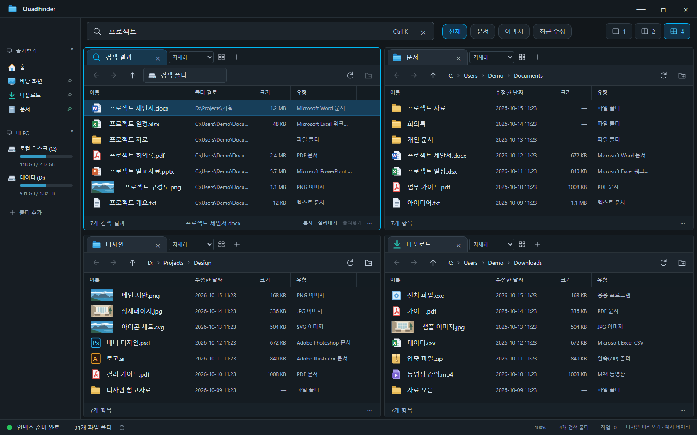
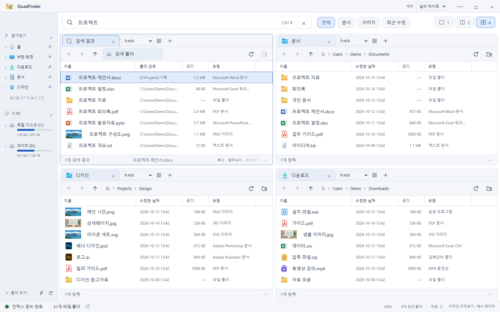

<div align="center">
  
  <h1>QuadFinder</h1>
  <p><strong>파일 검색과 다중 패널 탐색을 하나의 작업 공간에서.</strong></p>
  <p>Windows를 위한 파일 관리자 · 자체 로컬 인덱스 · 1·2·4분할 탐색</p>
  <p>
    <a href="https://github.com/junhyeok928/QuadFinder/actions/workflows/ci.yml"></a>
    
    
  </p>
  <p><a href="#주요-기능">주요 기능</a> · <a href="#시작하기">시작하기</a> · <a href="docs/usage.md">사용 가이드</a> · <a href="#개발">개발</a></p>
</div>

---

QuadFinder는 Everything의 파일명 검색과 Q-Dir의 다중 패널 탐색에서 영감을 받은 Windows 파일 관리자입니다. 여러 폴더를 나란히 열고, PC의 로컬 파일을 검색하고, 패널 사이에서 파일을 정리할 수 있습니다. 별도 Everything 설치 없이 자체 인덱스로 동작합니다.

> **공개 베타** · [GitHub 릴리스](https://github.com/junhyeok928/QuadFinder/releases)에서 설치 EXE 또는 포터블 ZIP을 다운로드하세요. [설치 안내](docs/installation.md)

## 화면



<p align="center"><sub>실제 앱을 예시 데이터로 실행한 화면입니다.</sub></p>

<details>
<summary><strong>실버 라이트 테마 보기</strong></summary>



</details>

## 주요 기능

| 기능 | 지원 내용 |
| :--- | :--- |
| **다중 패널 탐색** | 1·2·4분할, 패널별 독립 탭, 경계 드래그로 크기 조절 |
| **PC 파일 검색** | 로컬 고정·이동식 드라이브 자동 인덱싱, 파일명·확장자·경로·크기 조건 |
| **파일 작업** | 복사·이동·이름 변경·휴지통 삭제, 둘 다 유지·건너뛰기·덮어쓰기, 진행 표시·취소, 실행 취소 |
| **선택과 드래그** | 영역 드래그 선택, Ctrl·Shift 복수 선택, 패널 간 파일 복사·이동 |
| **보기 옵션** | 8가지 보기, 정렬·그룹화, 숨김 파일·확장명·확인란, 열 순서·너비 조절 |
| **미리보기** | 텍스트·이미지·PDF 미리보기, 파일 세부 정보 |
| **탐색 사이드바** | 즐겨찾기, 폴더 트리, 최근 폴더, 드라이브 용량, UNC 공유 폴더 바로가기 |
| **Windows 연동** | 탐색기와 클립보드 공유, 시스템 셸 확장 메뉴, 연결 프로그램·속성 |
| **화면 설정** | 뉴트럴 블랙·실버 라이트, Ctrl+휠 전체 배율, 탭·배치·폴더별 보기 저장 |

## 시작하기

### 실행본 사용

설치 버전은 `QuadFinder-Setup.exe`를 실행하세요. 포터블 버전은 ZIP 전체를 원하는 폴더에 풀고 `QuadFinder.exe`를 실행하세요. EXE 옆의 리소스와 DLL이 함께 필요합니다. 두 버전 모두 설정은 `%APPDATA%\QuadFinder`에 저장합니다.

첫 실행에는 인덱싱 안내와 간단한 사용법이 표시됩니다. 실행본은 시작 15초 후(설치 직후에는 60초 후), 이후 6시간마다 공개 릴리스를 확인합니다. 새 버전이 있으면 업데이트 버튼 오른쪽 위에 빨간 점이 표시되며, 버튼을 누르면 다운로드 페이지가 열립니다. 베타 버전은 새 베타와 정식 릴리스를 확인하고 정식 버전은 정식 릴리스만 확인합니다. 베타에서는 자동 다운로드·설치를 제공하지 않습니다.

```text
release/<버전>/
├── QuadFinder-win32-x64/                   # 실행 폴더
│   └── QuadFinder.exe
└── size-report.json                        # 빌드 용량 보고서
```

### 기본 사용 흐름

1. 사이드바에서 폴더를 열고 상단에서 **1·2·4분할**을 선택합니다.
2. 검색창에 파일명을 입력합니다. 로컬 드라이브는 자동 포함되므로 검색 폴더를 먼저 추가할 필요가 없습니다.
3. 파일을 선택하고 복사·붙여넣기하거나 다른 패널로 드래그합니다. **Shift+드래그**는 이동입니다.
4. 패널의 **보기 옵션**에서 표시 방식과 미리보기를 조절합니다.

자세한 조작 방법은 [사용 가이드](docs/usage.md)를 참고하세요.

## 검색

자체 SQLite 인덱스를 사용하며, 수집한 결과는 다음 실행에서도 재사용합니다. 파일 변경 시 해당 경로를 갱신하고, 첫 실행과 재시작 시에는 전체 범위를 확인합니다. 첫 수집 중에도 확인된 파일을 검색할 수 있습니다.

| 검색어 | 의미 |
| :--- | :--- |
| `프로젝트 보고서` | 두 단어를 모두 포함 |
| `"최종 보고서"` | 연속된 구문 포함 |
| `*.pdf` | 파일명 와일드카드 |
| `ext:pdf;docx` | 확장자 조건 |
| `path:Projects` | 경로 조건 |
| `size:>10mb` | 파일 크기 조건 |

**검색 범위:** 로컬 고정·이동식 드라이브. 모든 UNC 공유 폴더와 네트워크 드라이브는 인덱싱에서 제외하며, 폴더 탐색과 파일 작업은 지원합니다. 파일 본문 검색은 지원하지 않습니다.

현재는 파일 순회 기반으로, Everything의 NTFS MFT/USN 인덱싱과 같은 구조는 아닙니다. 파일 수와 디스크 속도에 따라 첫 인덱싱에 시간이 걸리며, 접근할 수 없는 폴더는 상태 표시줄의 인덱싱 진단에서 확인할 수 있습니다.

## 자주 쓰는 단축키

| 단축키 | 동작 |
| :--- | :--- |
| `Ctrl+K` / `Ctrl+L` | 검색창 / 활성 패널 경로 입력 |
| `Ctrl+T` / `Ctrl+W` | 새 탭 / 현재 탭 닫기 |
| `Ctrl+C` / `Ctrl+X` / `Ctrl+V` | 복사 / 잘라내기 / 붙여넣기 |
| `Ctrl+Z` | 복사·이동·이름 변경 실행 취소 |
| `F2` / `Delete` | 이름 변경 / 휴지통 이동 |
| `Alt+←` / `Alt+→` | 이전 / 다음 폴더 — 마우스 뒤로·앞으로 버튼도 지원 |
| `Alt+P` | 미리보기 전환 |
| `Ctrl+휠` / `Ctrl+0` | 전체 UI 확대·축소 / 기본 배율 |

[전체 단축키와 선택 방법 →](docs/usage.md#단축키)

## 개발

**환경:** Windows x64 · Node.js 24 권장(최소 22) · pnpm 11

```powershell
git clone https://github.com/junhyeok928/QuadFinder.git
cd QuadFinder
pnpm install --frozen-lockfile
pnpm start
```

Windows 셸·인덱스 도우미는 .NET Framework 4.x C# 컴파일러로 자동 빌드합니다. 패키징한 실행본에는 컴파일된 도우미가 포함됩니다. Electron 바이너리가 누락되었다면 `node node_modules/electron/install.js`를 실행하세요.

| 명령 | 용도 |
| :--- | :--- |
| `pnpm test` | 파일 시스템·검색·파일 작업 테스트 |
| `pnpm smoke` | 실제 Electron 입력으로 기능 통합 검사 |
| `pnpm design:check` | 테마·배율·작은 화면의 레이아웃 검사 |
| `pnpm preview` | 예시 데이터 기반 브라우저 UI 미리보기 |
| `pnpm release` | 로컬 실행 폴더 생성 (`pnpm package`와 동일) |
| `pnpm package:check` | 패키지 소스·필수 리소스·언어 파일 검증 |

GitHub의 [Windows checks](https://github.com/junhyeok928/QuadFinder/actions/workflows/ci.yml)는 테스트·UI 검사·패키징을 수행합니다. 기본 빌드는 실행 폴더만 생성합니다. 승인된 배포 시 `pnpm wizard`로 설치 파일을 별도 제작하고 검증합니다.

<details>
<summary><strong>프로젝트 구조</strong></summary>

```text
src/
├── main.cjs           # 앱 창, IPC, 설정, 폴더 감시
├── renderer/          # 탐색 UI, 선택, 메뉴, 미리보기
├── index-worker.cjs   # 검색 인덱싱 워커
├── index-store.cjs    # SQLite 인덱스 저장소
└── operations.cjs     # 파일 작업 큐, 검증, 취소
native/                # Windows 셸·인덱스 도우미
scripts/               # 빌드와 통합 검사
tests/                 # 자동 테스트
docs/                  # 사용 가이드와 화면 자료
```

</details>

## 지원 범위와 다음 단계

- **파일 작업:** 충돌 시 둘 다 유지·건너뛰기·덮어쓰기를 선택합니다. 폴더 덮어쓰기는 병합하며 대상에만 있는 파일을 유지합니다. 연결·정션이 포함된 폴더의 복사·이동은 지원하지 않습니다.
- **실행 취소:** 이번 실행에서 완료한 복사·이동·이름 변경을 지원합니다. 덮어쓴 항목은 실행 취소에서 제외하며 교체 전 항목은 휴지통으로 보관합니다. 삭제 복원과 재실행 이후의 기록 복원은 지원하지 않습니다.
- **미리보기:** 텍스트·이미지·PDF를 지원합니다. Office 문서 본문 미리보기는 향후 과제입니다.
- **개발 예정:** 대용량 검색 최적화와 NTFS 변경 기록 활용, 작업 다시 실행·삭제 복원, 네트워크 서버 탐색·계정 관리.

설정과 인덱스는 `%APPDATA%\QuadFinder`에 저장되며 사용자 파일 목록은 서버로 전송하지 않습니다. 인덱싱의 상세 정책과 권한 처리는 [사용 가이드](docs/usage.md#검색-범위와-제한), 구현 점검 기록은 [인덱싱 감사 문서](docs/indexing-v0.9-audit.md)에서 확인할 수 있습니다.

---

<sub>QuadFinder는 개발 중인 프로젝트입니다. 배포 라이선스는 아직 지정하지 않았습니다.</sub>
