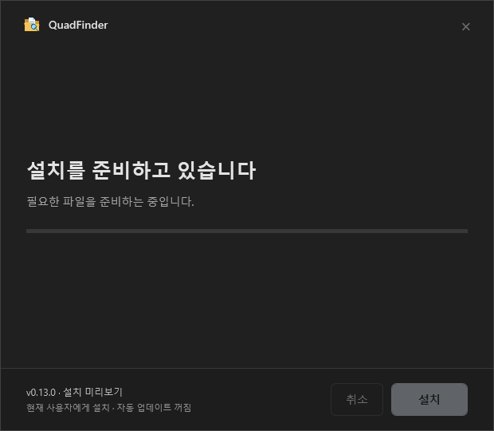

# 설치 UX 검토

[← README](../README.md)

설치 화면은 앱의 **뉴트럴 블랙** 톤을 따르는 전용 단일 창입니다. 현재 설치 파일은 출시 전 검토용이며 자동 업데이트를 사용하지 않습니다.

## 화면과 동작

1. **설치 옵션** — 위치와 바로가기를 한 화면에서 선택합니다. 시작 메뉴는 기본 선택, 바탕 화면은 기본 해제입니다.
2. **설치 진행** — 설치 버튼을 누른 뒤에만 내부 설치 엔진을 준비하고 무결성을 확인합니다. 준비와 설치는 백그라운드에서 처리하며, 설치 중에는 창을 닫아 파일 복사를 중단하지 않습니다.
3. **완료** — 설치 위치를 확인하고 닫습니다. 앱 실행은 사용자가 선택한 경우에만 진행합니다.





## 실행 대기 개선

기존 NSIS 기본 화면을 가벼운 .NET Framework WPF 화면으로 교체했습니다. 대용량 앱 파일은 첫 화면을 띄우는 과정에서 압축 해제하지 않으며, NSIS 내부 데이터도 단일 SOLID 블록 대신 파일별로 압축합니다. 설치 엔진은 설치 버튼을 누른 뒤에 준비하고 SHA-256을 확인합니다.

개발 PC에서 실제 크기의 이전·새 설치 파일을 실행해 **첫 창 감지**까지 측정한 결과입니다. 설치 버튼은 누르지 않았습니다.

| 대상 | 첫 창 감지 | 파일 크기 |
| --- | ---: | ---: |
| 이전 기본 마법사 | 5.47초 | 약 104 MB |
| 새 전용 설치 화면 | 1.53초 | 약 105 MB |

한 PC에서의 단일 비교 측정입니다. 디스크·백신 검사·캐시 상태에 따라 실행 시간은 달라집니다. 측정 스크립트는 `scripts/measure-setup-startup.ps1`이며 자신이 실행한 설치 프로세스만 종료합니다.

## 설치와 제거

현재 사용자 계정의 `%LOCALAPPDATA%\Programs\QuadFinderPreview`에 설치합니다. 설정은 `%APPDATA%\QuadFinder`를 공유합니다. 새 UI는 Windows 10/11의 .NET Framework 4.8 환경을 기준으로 합니다.

제거는 기존 NSIS 제거 엔진을 사용합니다. 설정·즐겨찾기·검색 인덱스는 기본 보존하며, 사용자가 선택하면 함께 제거합니다. 실제 문서·사진·즐겨찾기 대상 폴더는 제거하지 않습니다.

## 제작과 확인

기본 `pnpm release`는 실행 폴더만 생성합니다. 설치 UI를 명시적으로 검토할 때에만 다음 명령을 사용합니다.

```powershell
pnpm wizard
node scripts/check-wizard.cjs --fixtures-only --screenshots
node scripts/check-wizard-artifact.cjs
```

검토용 파일: `release/<버전>/wizard/QuadFinder-Setup.exe`

화면은 `installer/setup-window.xaml`, 동작은 `installer/SetupWindow.cs`, 파일 설치·제거는 `installer/quadfinder.nsi`에서 관리합니다. 기존 `installer` 명령의 Squirrel 제작 코드는 별도로 보존되어 있으며 이 검토용 설치본과 구분됩니다.

검사는 별도 테스트 폴더·전용 레지스트리·테스트 바로가기를 사용합니다. UI 기본 선택, 보호 폴더 거부, 바로가기 선택 반영, 무인 설치(`/S`), 재설치, 설정 보존·선택 삭제, 무관한 파일 보존을 검증합니다. 실제 설치 파일에서는 UI 소스·내장 엔진·앱·도우미의 해시를 확인합니다.
