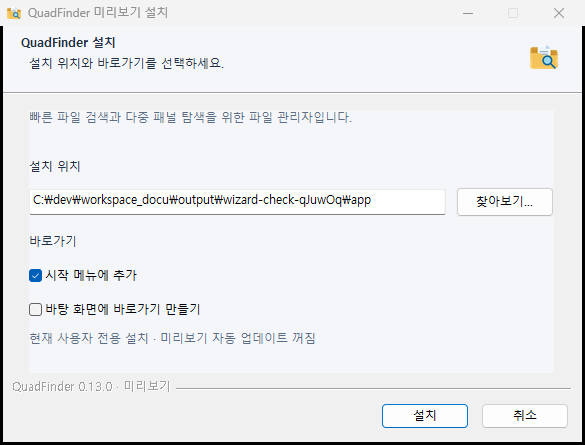
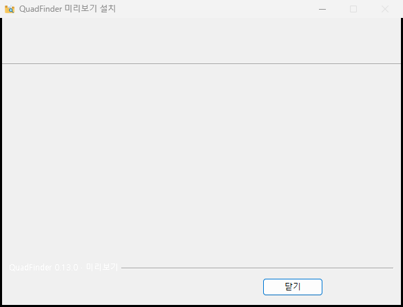

# 설치 UX 검토

[← README](../README.md)

설치 화면은 실버 라이트 톤의 간결한 3단계로 구성합니다. 현재 설치 파일은 출시 전 검토용이며 자동 업데이트를 사용하지 않습니다.

## 설치 흐름

1. **설치 옵션** — 위치 선택, 시작 메뉴·바탕 화면 바로가기 설정을 한 화면에서 진행합니다. 시작 메뉴는 기본 선택, 바탕 화면은 기본 해제입니다.
2. **설치 진행** — 파일 설치 진행 상황을 표시합니다.
3. **완료** — 설치 위치를 확인하고 닫습니다. 앱 실행은 사용자가 선택한 경우에만 진행합니다.





## 제거 흐름

제거 옵션 → 제거 진행 → 완료 순서입니다. 설정·즐겨찾기·검색 인덱스는 기본 보존하며, 사용자가 선택하면 함께 제거합니다. 실제 문서·사진·즐겨찾기 대상 폴더는 제거하지 않습니다.

## 제작과 확인

기본 `pnpm release`는 실행 폴더만 생성합니다. 설치 UI를 명시적으로 검토할 때에만 다음 명령을 사용합니다.

```powershell
pnpm wizard
node scripts/check-wizard.cjs --fixtures-only --screenshots
node scripts/check-wizard-artifact.cjs
```

검토용 파일: `release/<버전>/wizard/QuadFinder-Setup.exe`

`wizard`는 이 문서의 NSIS 마법사이며, 기존 `installer` 명령의 Squirrel 제작 코드는 별도로 보존되어 있습니다. 두 설치 경로는 구분됩니다. 검토용 설치는 현재 사용자 계정의 `%LOCALAPPDATA%\Programs\QuadFinderPreview`에 설치하며, 설정은 `%APPDATA%\QuadFinder`를 공유합니다.

검사는 별도 테스트 폴더·전용 레지스트리·테스트 바로가기를 사용합니다. UI 기본 선택, 재설치, 설정 보존·선택 삭제, 무관한 파일 보존과 실제 설치 파일의 앱·도우미 포함 여부를 확인합니다.
