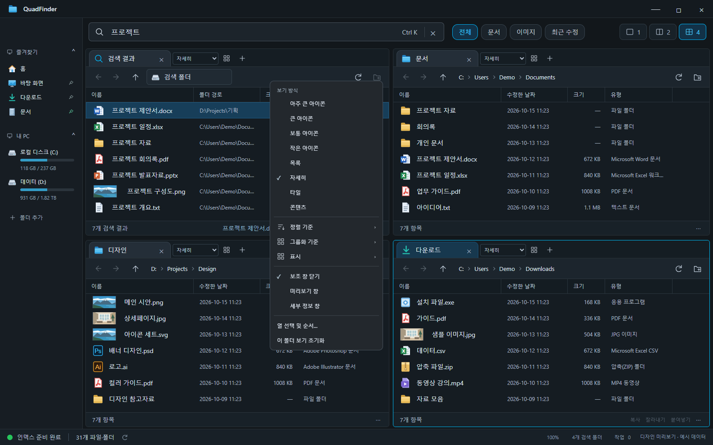

# 사용 가이드

[← README](../README.md)

QuadFinder의 탐색·검색·파일 작업과 단축키를 안내합니다.

## 드래그 선택

파일 목록의 빈 공간에서 마우스 왼쪽 버튼을 누르고 드래그하면 선택 영역에 들어온 파일을 함께 선택합니다. Ctrl을 누르면 기존 선택을 반전하고, Shift를 누르면 기존 선택에 추가합니다. Esc는 드래그 시작 전 선택으로 되돌립니다. 목록 가장자리로 이동하면 자동 스크롤합니다. 파일 이름이나 아이콘을 드래그하면 파일 복사·이동으로 동작합니다.

## 화면 조절

사이드바와 패널 경계를 드래그해 크기를 조절합니다. 경계를 더블클릭하면 기본 너비 또는 균등 분할로 돌아갑니다. 경계에 포커스한 뒤 방향키·Home·End로도 조절할 수 있습니다. Ctrl+휠은 전체 UI 배율을 70~150%로 조절하고 Ctrl+0은 기본 100%로 초기화합니다. 배율·테마·배치는 자동 저장됩니다.

최근 폴더는 방문한 폴더를 최대 10개까지 최신순으로 저장합니다. Ctrl+클릭 또는 휠클릭으로 새 탭에서 열 수 있으며 기록을 지워도 실제 폴더는 삭제하지 않습니다.

## 보기 옵션과 우클릭

패널 탭 옆의 보기 옵션 버튼에서 숨긴 항목·확장명·확인란, 정렬·그룹화, 미리보기·세부 정보 창을 설정합니다. 자세히 보기에서는 열 경계를 드래그하거나 더블클릭해서 너비를 맞추고, 열 제목을 드래그하여 순서를 바꿉니다. 열 제목 우클릭으로 열을 추가·제거할 수도 있습니다. 설정은 폴더별로 저장하며 보기 옵션에서 초기화할 수 있습니다.

파일과 폴더 배경의 일반 우클릭은 Windows 네이티브 시스템 메뉴를 엽니다. 설치된 셸 확장(압축 도구·Git 등)이 표시되며, 보기·정렬·분류·새로 고침·붙여넣기 등 탐색 창의 기본 명령도 연결됩니다. Windows 11에서는 탐색기의 **추가 옵션 표시**에 해당하는 메뉴이며, 시스템 테마와 설치된 확장에 따라 항목과 모양이 달라집니다. 검색 결과에서 서로 다른 폴더의 항목을 함께 선택하면 네이티브 메뉴에 복사·잘라내기·삭제·경로 복사를 제공합니다. 앱이 제공하는 기본 파일 작업은 작업 큐·충돌 확인·실행 취소와 연동되며, 외부 셸 확장의 자체 명령은 해당 프로그램이 처리합니다.

미리보기는 로컬 텍스트(앞부분 128 KB), PNG/JPEG/WebP/BMP/GIF/AVIF 이미지와 PDF를 지원합니다. 40 MB를 초과하는 파일은 내용 미리보기를 생략합니다. 텍스트와 HTML은 실행하지 않고 글자로 표시하며 PDF는 Chromium의 PDF 뷰어를 사용합니다. Word·Excel 본문 미리보기는 아직 지원하지 않습니다.

## 네비게이션

- 즐겨찾기·내 PC 제목을 클릭하거나 Enter/Space로 접기·펼치기. 접힘 상태는 저장됩니다.
- 각 항목 왼쪽 화살표로 하위 폴더를 펼칩니다. 실제로 펼친 폴더만 읽고, 접힌 섹션의 하위 폴더는 펼칠 때 불러옵니다. 오류 시 다시 시도할 수 있습니다.
- 현재 폴더 고정 버튼, 폴더 경로 입력 또는 선택으로 로컬·UNC 폴더를 추가합니다. `검색 대상에도 포함`을 끄면 바로가기만 추가합니다.
- 추가한 바로가기의 드래그 순서 변경, 우클릭으로 표시 이름 변경·위아래 이동·제거. 표시 이름과 순서를 저장하며 실제 폴더는 변경하지 않습니다.
- Ctrl+클릭·휠클릭 또는 우클릭 메뉴로 새 탭에서 열기, 다른 패널에서 열기, Windows 탐색기 열기, 경로 복사·속성을 제공합니다.
- 즐겨찾기 제목이나 고정 영역에 폴더를 놓으면 바로가기로 고정합니다. 폴더 항목에 파일을 놓으면 해당 폴더로 복사하고 Shift를 누르면 이동합니다.
- 바로가기 제거와 검색 대상 제외는 별도 명령입니다. 네비바에서 Delete는 추가한 바로가기만 제거하며 실제 폴더를 삭제하지 않습니다.
- 네비바 새로고침 버튼·F5로 폴더 트리와 드라이브 용량을 다시 확인합니다. 방향키로 항목 이동·펼치기·접기를 지원하며 목록이 길면 네비바 안에서 스크롤합니다.

## 파일 작업

파일을 Ctrl/Shift로 여러 개 선택한 뒤 Ctrl+C 또는 Ctrl+X, 대상 패널에서 Ctrl+V를 사용합니다. 드래그는 기본 복사이고 Shift를 누르면 이동합니다. F6으로 대상 폴더를 직접 골라 이동할 수도 있습니다. Delete는 확인 후 Windows 휴지통으로 보냅니다. 앱 자체 삭제는 휴지통 이동이며, 시스템 확장 메뉴에서 실행하는 명령은 Windows와 설치된 셸 확장 프로그램이 처리합니다.

앱 작업 큐의 이동은 복사를 완료하고 원본이 바뀌지 않았는지 확인한 뒤 원본을 휴지통으로 보냅니다. 따라서 원본은 Windows 휴지통에서 복원할 수 있고, 복사 중에는 추가 여유 공간이 필요합니다. 원본 변경 또는 휴지통 오류가 나면 원본을 유지하고 작업 창에 오류를 표시합니다. 완료된 항목은 작업 취소 시 되돌리지 않습니다. 실행 중인 작업이 있으면 창을 닫기 전에 완료하거나 취소해야 합니다.

파일 실행·삭제·충돌 확인은 현재 테마를 따르는 앱 확인창으로 표시합니다. 충돌 시 **둘 다 유지·건너뛰기·덮어쓰기** 중 선택하며, 같은 작업의 모든 충돌에 적용할 수 있습니다. Esc 또는 취소는 실행·삭제를 승인하지 않으며, 충돌 확인에서는 남은 작업을 취소합니다.

덮어쓰기는 먼저 별도 임시 영역에 완성본을 준비한 뒤 교체합니다. 폴더끼리는 병합하며 대상에만 있던 파일은 유지합니다. 파일과 폴더의 유형이 다르면 가져올 항목으로 교체합니다. 교체 전 항목은 휴지통에 보관합니다. 휴지통 이동에 실패하면 기존 항목을 보존한 경로를 작업 오류에 표시하고 이동 원본도 유지합니다. 덮어쓴 항목은 Ctrl+Z 대상에서 제외하고 이전 실행 취소 기록을 초기화합니다. 연결·정션이 포함된 폴더 복사/이동은 지원하지 않습니다. 네트워크 공유의 휴지통 이동 가능 여부는 Windows와 공유 서버의 지원에 따르며, 실패하면 오류를 표시하고 영구 삭제로 대신하지 않습니다. Windows 파일 클립보드를 공유하므로 탐색기와 Ctrl+C/X/V로 파일을 주고받을 수 있습니다. 외부 파일은 드래그해서 가져올 수 있습니다.

## 검색 범위와 제한

시작할 때 연결된 로컬 고정·이동식 드라이브를 자동 검색 범위로 사용합니다. 기존 검색 폴더 설정이 있어도 전체 드라이브가 포함되며 폴더를 수동으로 추가할 필요가 없습니다. 네트워크·광학 드라이브는 자동 수집하지 않습니다. 새 드라이브 연결 후에는 앱을 다시 시작하세요. 접근 권한이 없는 폴더는 건너뜁니다. 설정과 인덱스 DB(`index.sqlite`)는 로컬 앱 데이터 폴더에 저장합니다. 기존 JSON 캐시는 한 번 가져오고 보존하지만 더 이상 전체 JSON으로 다시 저장하지 않습니다. 심볼릭 링크·재분석 지점과 앱 자체 설정 폴더, 시스템 휴지통 및 System Volume Information은 제외합니다. `.git`과 `node_modules`는 포함합니다. SQLite 디스크 저장소를 사용하며 이전 25만 항목 제한을 제거했습니다. 검색 결과는 상위 1,000개를 표시합니다. 일반 폴더 목록은 2,000개씩 추가 표시할 수 있습니다. 파일 본문은 검색하지 않습니다.

폴더 변경을 감지해 해당 파일 또는 하위 폴더만 갱신합니다. 주기적인 전체 재수집은 하지 않으며, 변경 감지가 지원되지 않는 볼륨에서는 수동 갱신이 필요합니다. 수동 갱신은 상태 표시줄의 새로고침으로 가능합니다. 첫 수집에는 파일 수와 디스크 속도에 따라 시간이 필요하고, 캐시를 읽은 뒤에는 이전 결과로 검색하면서 갱신합니다.

| 검색어 예시 | 동작 |
|---|---|
| `프로젝트 보고서` | 두 단어를 모두 포함 |
| `"최종 보고서"` | 연속된 구문 포함 |
| `*.pdf` | 파일명 와일드카드 (`*`, `?`) |
| `ext:pdf;docx` | 확장자 조건 |
| `path:Projects` | 경로 조건 |
| `size:>10mb` | 파일 크기 조건 (`b`, `kb`, `mb`, `gb`, `tb`) |

탭 경로는 앱 데이터 폴더에 저장되며 Git에 포함되지 않습니다. 앱은 사용자 파일 목록을 서버로 전송하지 않습니다. Electron 렌더러의 Node 접근을 차단하고, 제한된 preload API로 파일 작업을 수행합니다.

## 보호 폴더 인덱싱

상태 표시줄의 **인덱싱 상태 → 관리자 권한으로 다시 인덱싱**을 누르면 Windows UAC 승인 후 읽기 전용 `QuadFinder.Index.exe` 도우미만 승격합니다. 파일 관리자 자체는 기존 권한을 유지합니다. 도우미는 로컬 고정·이동식 드라이브의 이름·크기·시각·속성 열거만 지원하며 파일 본문 읽기·쓰기·ACL/소유권 변경은 지원하지 않습니다. UAC를 취소하거나 연결에 실패하면 일반 권한으로 계속합니다. 관리자 모드는 현재 실행 동안만 유지합니다. Windows가 SYSTEM/TrustedInstaller 등에 제한한 폴더까지 모두 읽을 수 있다고 보장하지 않습니다. 네트워크 제외 정책은 관리자 모드에서도 유지합니다.

일반 권한의 자동 테스트는 SQLite 재시작·25만 건 초과·네이티브 긴 경로·페이지 전송·오류 진단 UI를 검증합니다. 실제 UAC 승인 및 보호 폴더 권한 확대는 사용 환경에서 별도 확인이 필요합니다. 현재 구현은 MFT/USN 인덱서가 아니므로 첫 전체 순회와 재시작 후 변경 확인은 필요합니다.

## 단축키

| 단축키 | 동작 |
|---|---|
| Ctrl K | 검색창 포커스 |
| Ctrl + 마우스 휠 / Ctrl + +·- | 전체 화면 크기 조절 |
| Ctrl 0 | 배율 100%로 초기화 |
| Ctrl T | 활성 패널 새 탭 |
| Alt P | 미리보기 창 켜기·끄기 |
| 우클릭 / 메뉴 키 | Windows 시스템 메뉴 |
| Shift+우클릭 / Shift+F10 | 추가 명령을 포함한 Windows 시스템 메뉴 |
| Ctrl Shift C | 선택한 파일의 경로 복사 |
| Ctrl W | 활성 패널 현재 탭 닫기 |
| Ctrl L | 활성 패널 경로 입력 (또는 경로 더블클릭) |
| Ctrl A / Ctrl·Shift+클릭 | 현재 표시한 파일 전체 / 복수·범위 선택 |
| Ctrl C / Ctrl X / Ctrl V | 복사 / 잘라내기 / 붙여넣기 |
| Ctrl Z | 이번 실행의 복사·이동·이름 변경 실행 취소 |
| Ctrl Shift N | 새 폴더 |
| F2 | 이름 변경 |
| F6 | 대상 폴더를 선택하여 이동 |
| Delete | 휴지통 이동 |
| Alt Enter | 파일 정보 |
| 마우스 뒤로/앞으로 버튼 · Alt ←/→ | 활성 패널의 현재 탭에서 이전/다음 폴더 |
| Alt ↑ | 상위 폴더 |
| F5 | 활성 패널 새로고침 |
| Enter | 선택한 파일 열기 / 폴더 이동 · 팝업에서는 변경·추가·삭제·적용 등 긍정 동작 |

### 팝업과 클립보드 조작

앱 팝업에서 Enter는 긍정 동작을 실행합니다. 취소 버튼에 포커스가 있어도 동일하며, 취소하려면 Esc 또는 취소 버튼을 클릭하세요. 여러 충돌 선택지가 있으면 선택한 긍정 버튼을 실행하며 기본값은 둘 다 유지입니다. 한글 조합 중 Enter는 확인으로 처리하지 않습니다.

파일 목록을 한 번 클릭하면 해당 패널로 키보드 포커스가 이동합니다. 복사·잘라내기 직후에도 클립보드 쓰기 완료 후 붙여넣기를 처리하며, 잠시 사용 중인 Windows 클립보드는 재시도합니다.

### 외부 프로그램으로 파일 첨부

파일 목록에서 선택한 파일을 메일·브라우저의 첨부 영역으로 드래그하면 Windows 네이티브 파일 데이터로 전달합니다. 여러 파일과 한글 이름도 지원하며 원본 파일은 유지됩니다. 파일·폴더 수용 여부와 첨부 용량은 대상 프로그램의 규칙을 따릅니다. 내부 패널로 드롭하면 기존 복사·Shift 이동 동작을 사용합니다. 구현은 [Electron 네이티브 파일 드래그 API](https://www.electronjs.org/docs/latest/tutorial/native-file-drag-drop/)를 사용합니다.

개발 PC의 전경 창에서 실제 Windows 드래그를 확인하려면 `pnpm exec electron . --smoke-test --native-drag-test`를 실행합니다. 로컬 수신 창에서 파일 이름·내용과 내부 패널 복사를 검사하며, 기본 CI는 네이티브 드래그 IPC 연결과 경로 검증을 확인합니다.

### 드롭과 작업 창

원래 파일이 들어 있는 폴더로 다시 드롭하면 복사·이동하지 않고 작업도 생성하지 않습니다. 다른 패널에 같은 폴더를 열었거나 같은 위치의 경로 별칭을 사용해도 동일합니다. Ctrl+C / Ctrl+V로 같은 폴더에 사본을 만드는 동작은 유지됩니다.

자동으로 열린 파일 작업 창은 모든 작업이 끝난 뒤 약 1.5초 후 닫힙니다. 작업 기록은 보존되며 하단 작업 버튼으로 다시 볼 수 있습니다. 직접 연 기록 창은 자동으로 닫히지 않습니다.

파일 목록의 휠 스크롤은 Chromium의 긴 부드러운 스크롤 애니메이션을 끄고 즉시 이동하도록 구성했습니다. Ctrl+휠 배율 조절은 유지합니다.
